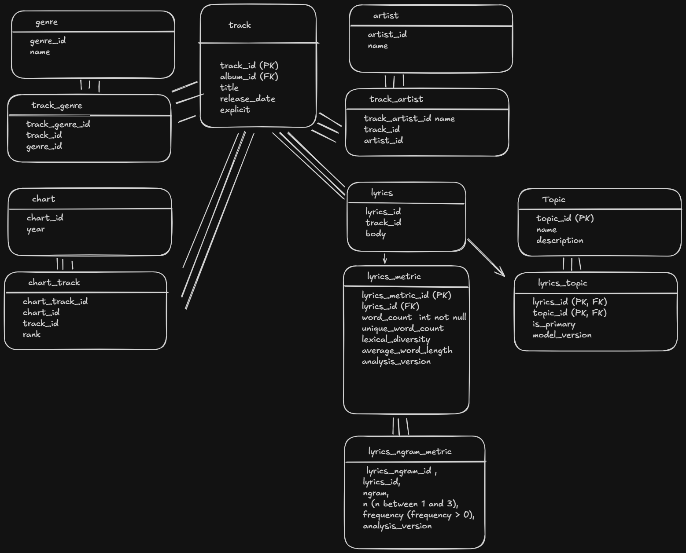
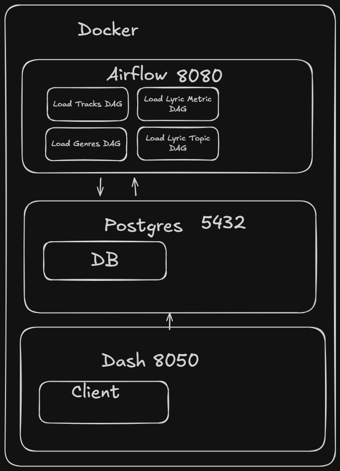

# Proposal: Did the themes of popular music actually change from 2000 to 2024, or did the genres represented on the charts change?

> How have the lyrical themes of Billboard's most popular songs evolved from 2000 to 2024 in the US, and how do those themes relate to genre and musical characteristics?

## Secondary questions

- How did the characteristics of the sound change (sound analysis)?
  - Does a particular characteristic dominate?
  - Has it shifted?
- What words / phrases were used most frequently across genres / topics?
- What topics / genres dominated charts?

## Data Sources

- Billboard Rankings by Year w/ lyrics — [link](https://github.com/tmelo-uea/billboard-hot100-lyrics/blob/main/billboard-year-end-2020-lyrics.csv)
- Kaggle Track Analysis and Track Genre Enrichment — [link](https://www.kaggle.com/datasets/amitanshjoshi/spotify-1million-tracks)
- MusicBrainz API for secondary enrichment — [link](https://musicbrainz.org/doc/MusicBrainz_API#Search)
- OpenAI API for Lyrics Topic Classification — [link](https://openai.com/api/)
- NLTK for NLP word and n-gram analysis — [link](https://www.nltk.org/api/nltk.util.html#nltk.util.ngrams)

## Proposed topics from Billboard Rankings

- `love_relationships`
- `heartbreak_loss`
- `sex_desire`
- `self_reflection_growth`
- `empowerment_confidence`
- `party_celebration`
- `lifestyle_success`
- `social_commentary`
- `faith_spirituality`
- `other`

## Key Hypotheses and analysis parameters

### Lyrical themes have shifted over the last 25 years

- Top 5 topics now vs then
- The percentage of songs about `heartbreak_loss` has always been highest?
- The number of hits that are explicit has gone up
- The number of songs about `self_reflection_growth` has gone down
- Most songs are not about `self_reflection_growth`

### Different genres emphasize different lyrical themes

- Love and relationships is the most popular topic of R&B
- Pop music emphasizes `party_celebration` and `lifestyle_success`
- Pop becomes increasingly more about `party_celebration` instead of heartbreak

### Vocabulary and commonly used phrases have changed

- NLP word and n-gram analysis

### Changes in lyrical topics are partly explained by changes in genre popularity

- Within-genre versus overall trends

## Schema Design

## ETL

### Sources

- Billboard Rankings by Year w/ lyrics — [link](https://github.com/tmelo-uea/billboard-hot100-lyrics/blob/main/billboard-year-end-2020-lyrics.csv)
- Kaggle Track Analysis and Track Genre Enrichment — [link](https://www.kaggle.com/datasets/amitanshjoshi/spotify-1million-tracks)
- MusicBrainz API for secondary enrichment — [link](https://musicbrainz.org/doc/MusicBrainz_API#Search)
- OpenAI API for Lyrics Topic Classification — [link](https://openai.com/api/)
- NLTK for NLP word and n-gram analysis — [link](https://www.nltk.org/api/nltk.util.html#nltk.util.ngrams)

### Challenges

- Kaggle dataset is incomplete; some songs will be missing sound analysis.
  - Will use MusicBrainz to supplement genres.
- Genres are album level, not track level.
  - Will use album-level genre and choose one broad genre.
- AI classification is prone to hallucination.
  - Will use structured output and prompt engineering to mitigate this.

### Process — Docker, Spark, Airflow, PostgreSQL

1. Extract and clean ranking CSVs.
2. Extract and clean Spotify set.
3. Enrich with MusicBrainz.
   - genres, album, other artists
   - Batch
   - Rate limit
4. Load tracks, artists, albums, genres, charts, chart tracks, lyrics, topics.
5. Create NLP model to load track lyrics metrics.
   - lyric metric, lyric_ngram_metric
6. Create LLM client to classify using topic map.
   - lyric_topic
   - Batch
   - Rate limit
7. Load lyric metrics and lyrics topics.

## Visualize

### Themes over Time

| Chart | Type | X-axis | Y-axis / encoding |
|---|---|---|---|
| Top 5 lyrical topics: 2000 vs. 2024 | Grouped horizontal bar chart | Percentage of songs | Lyrical topic; bars grouped by year (2000 vs. 2024) |
| Lyrical topic popularity over 25 years | Multi-line chart | Year (2000–2024) | Percentage of songs; one line per topic, selectable/hideable |
| Lyrical topic heatmap | Heatmap | Year (2000–2024) | 10 normalized topics; color: percentage of songs assigned |
| Explicit songs over time | 100% stacked line chart | Time | Explicit song percentage |
| Biggest lyrical topic increases and decreases | Diverging bar chart | Percentage-point change between periods | Lyrical topic |

### Words Over Time

| Chart | Type | X-axis | Y-axis / description |
|---|---|---|---|
| Most common words by year | Horizontal bar chart | Word frequency | 10–20 most frequent words for selected year |
| Word/phrase popularity over time | Multi-line chart | Year (2000–2024) | Frequency per 10,000 words |
| Vocabulary diversity over time | Line chart | Year (2000–2024) | Average lexical diversity (MTLD; higher = more varied vocabulary) |
| Song word count over time | Multi-line chart | Year (2000–2024) | Average total and unique word counts |
| Song length vs. vocabulary diversity | Scatter plot | Word count | Lexical diversity (MTLD) |

### Themes in Genres

| Chart | Type | X-axis | Y-axis |
|---|---|---|---|
| Most popular lyrical topics by genre | Grouped horizontal bar chart | Percentage of songs | Lyrical topic |
| Lyrical topic trends within a genre | Multi-line chart | Year (2000–2024) | Percentage of songs with each topic |

### Words in Genre

| Chart | Type | X-axis | Y-axis |
|---|---|---|---|
| Vocabulary diversity by genre | Box plot | Genre | Lexical diversity (MTLD) |
| Vocabulary diversity by genre over time | Multi-line chart | Year (2000–2024) | Average lexical diversity (MTLD) |

## Architecture

| Layer | Technology |
|---|---|
| Orchestration | Apache Airflow |
| Extraction | Python, Requests |
| Transformation | Pandas, NLP, Python |
| Storage | PostgreSQL |
| Database access | SQLAlchemy / psycopg |
| Visualization | Plotly Dash |
| Infrastructure | Docker Compose |

## Tasks

| Task | Estimated time |
|---|---|
| Exploratory Data Analysis of each dataset | 8 hours |
| Importing data (from CSV, database, API, etc.) | 8 hours |
| Database design (ERD, DDL) | 2 hours |
| Data cleaning: where (Airflow, Jupyter) and how (Pandas, Spark, Dask, Polars) | 8 hours |
| Airflow DAG | 8 hours |
| Sketches: visualizations and dashboards | 1 hour |
| Dashboard creation | 8 hours |
| Presentation prep: creation, practice, contingencies | 8 hours |
