# Technical Report

## Goal

Find trends in the lyrics and sound of Billboard's Year-End Hot 100 from 2000 to 2024. The analysis covers genre mix, lyrical topics, vocabulary, explicit language, emotion, audio features and links to the economy.

## Data

| Source | Provides |
|---|---|
| Billboard Year-End Hot 100 lyrics (Melo, GitHub) | 2,484 chart entries (2,247 unique tracks) with lyrics |
| Spotify 1 Million Tracks (Kaggle) | Song length and audio features |
| iTunes Search API | Genre and explicit flag per track |
| TypeSafe Jev | Main lyrical topic per track |
| NRC Emotion Lexicon | Emotion tags for words |
| Profanity list (Kaggle) | Strong profanity words |
| FRED | Unemployment, consumer sentiment, birth rate |

## Architecture

- **Pipeline:** a single Airflow DAG in Docker runs four stages: schema and views, core ETL, lyrics analysis, and genre enrichment.
- **Storage:** Postgres (Cloud SQL, through the Cloud SQL Auth Proxy) in a `billboard_lyrics` schema. SQL views shape the data for the dashboard.
- **Dashboard:** Plotly Dash with eight sheets. Repository classes query the views, and shared helpers keep colors, periods and tables consistent across sheets.
- **Code style:** small, task-sized processors and transformers with their I/O injected, so each step can be tested and retried on its own.

## Key techniques

- **Track matching:** Billboard, Spotify and iTunes spell titles and artists differently. Names are normalized (accents, featured credits, version tags, aliases), then candidates are matched on artist and ranked so the charting version wins over live versions and remixes.
- **Lyrics NLP:** lyrics are cleaned of scrape artifacts and section headers and tokenized with nltk. Each song gets word counts, lexical diversity (MTLD) and 1–3 word n-gram counts, with stopwords and filler words filtered out.
- **API snapshots:** iTunes and TypeSafe results are saved to CSVs. Reruns load the snapshot first and only call the APIs for tracks it doesn't cover.
- **Versioned analysis:** lyric metrics and topics store an analysis version, so the analysis can be rerun without overwriting earlier results.
- **Analysis methods:** shares are compared across three periods (2000–07, 2008–16, 2017–24). Distinctive words are ranked by lift against other groups, and economic links use Pearson correlation.

## Challenges

- **Matching tracks across sources:** 165 entries have no iTunes match and 363 have no Spotify match, and recent years are missing more often.
- **Cleaning lyrics:** scraped lyrics contain ads, contributor counts and section headers that would otherwise count as words.
- **Model-made topics:** topics come from a model, not hand labels.

## Testing

pytest specs cover the transformers, lyrics analyzers and genre enrichers.

## Key findings

### Genre

Country/Folk and Hip-Hop/Rap grew while R&B/Soul and Rock/Alternative faded.

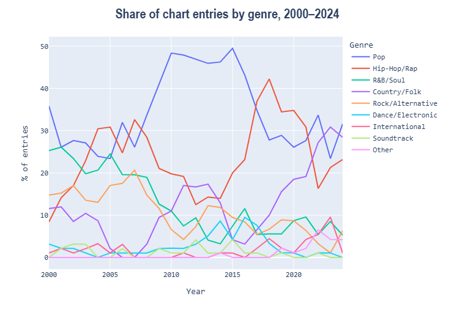

### Topic

Lifestyle & Success more than doubled, driven by hip-hop. Heartbreak overtook Love as the top topic in 2024.

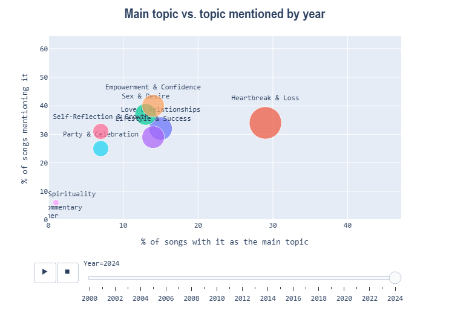
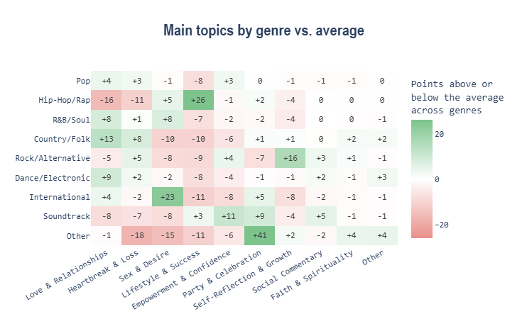

### Vocabulary

"Girl", "love" and "club" faded while rap slang and strong profanity rose. Each genre has its own distinctive words.

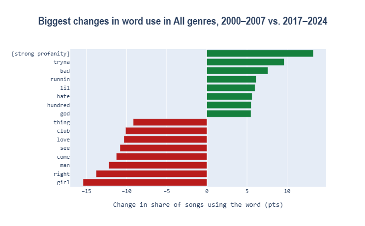
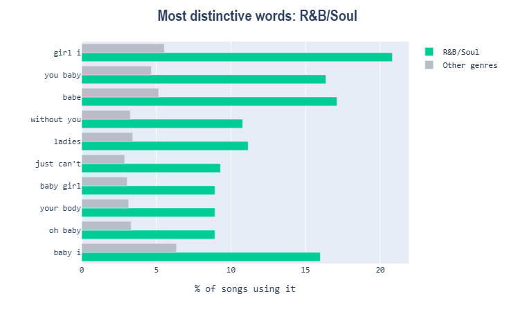

### Explicit

Explicit words nearly doubled, and the rise spread across all genres.

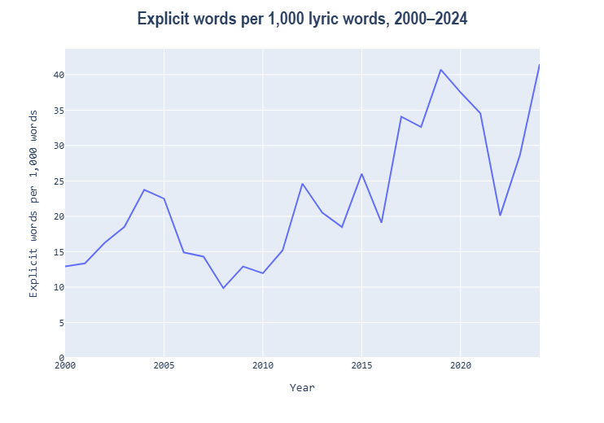
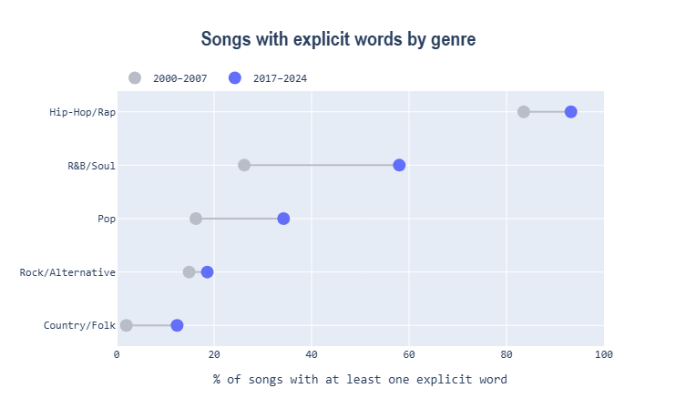

### Emotion

Fear and anger words rose while joy and positive words fell.

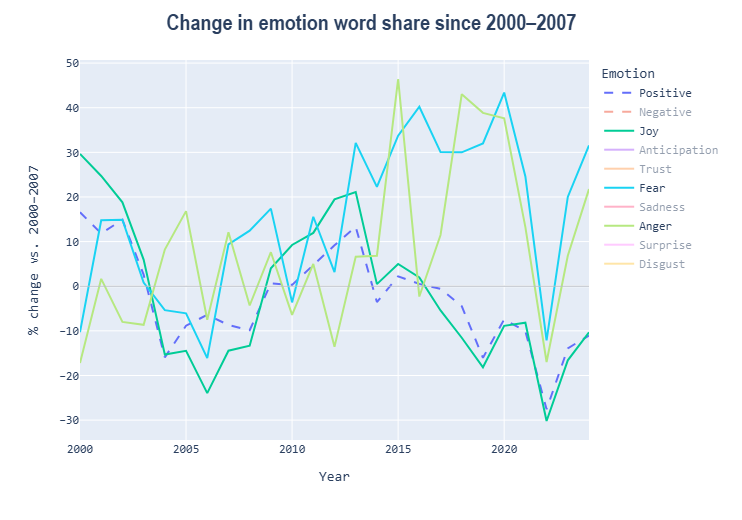
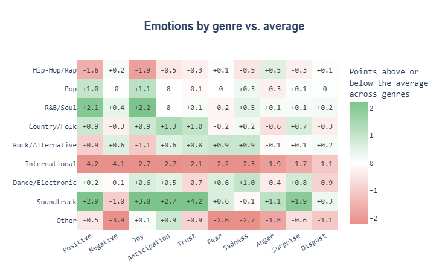

### Sound

Hits got 15% shorter and sound sadder and calmer.

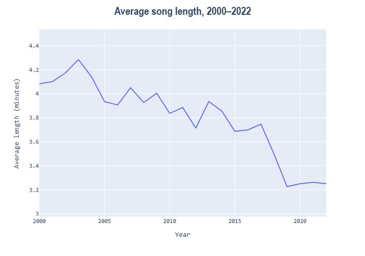
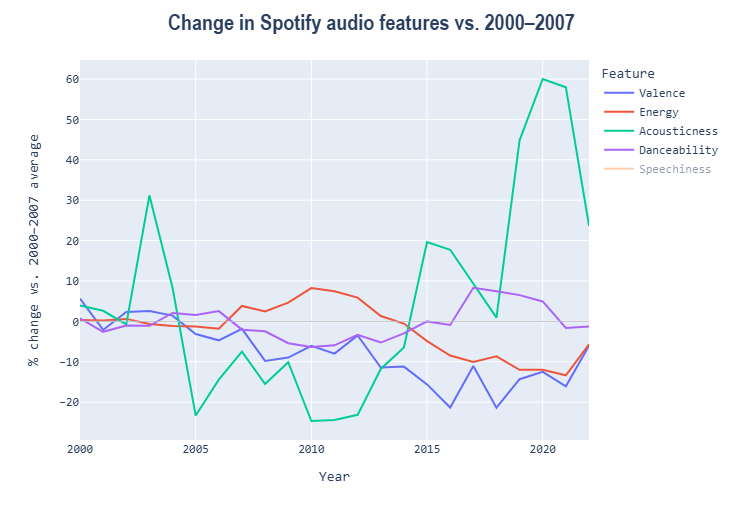

### Economy

Party songs track unemployment (r = +0.67), the strongest of 30 indicator–topic pairs.

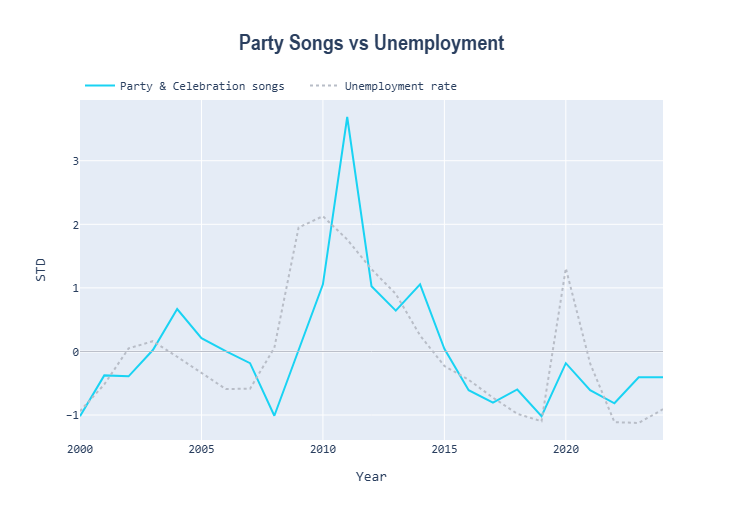
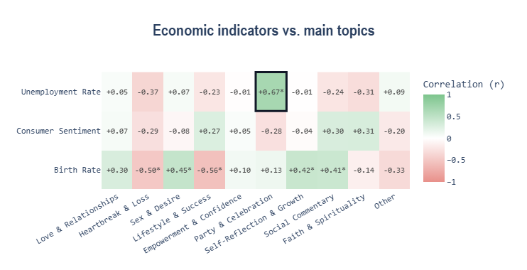
